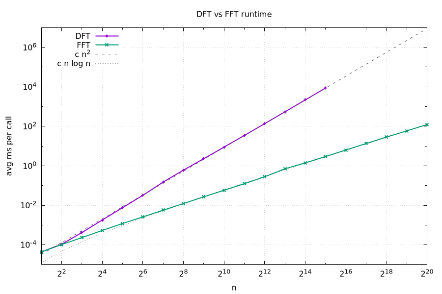
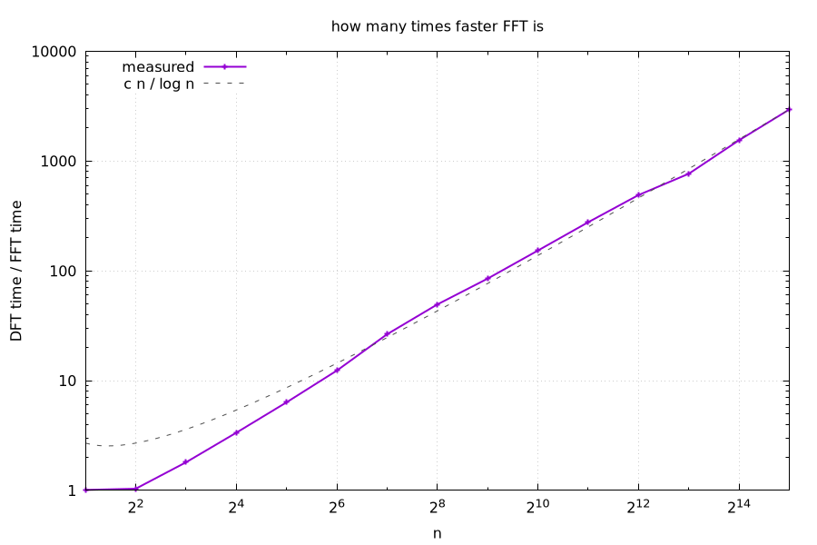

# Assignment 6: DFT vs FFT

For the deep dive I implemented the Discrete Fourier Transform two ways in C++: the naive O(n^2) DFT and the recursive Cooley–Tukey FFT (radix-2), which is O(n log n). Then I checked they give the same answers and benchmarked them.

- `DFT.hpp`: naive DFT
- `FFT.hpp`: recursive FFT, only works when n is a power of 2
- `Tests.cpp`: unit tests
- `Benchmark.cpp`: timing, prints the numbers and draws `results.png` + `speedup.png` with gnuplot

## How I learned it

Before writing any code I watched 3Blue1Brown's "But what is the Fourier Transform? A visual introduction" on YouTube to get what the Fourier transform is actually doing. Then I looked at some other videos and articles about how the Cooley–Tukey FFT works. The part I kept getting stuck on was the combine step, how two half-size DFTs give back all N outputs, so I asked AI about the things I was confused about until it made sense. After that I started coding.

## How the algorithms work

**DFT**:

```
X[k] = sum over j = 0..N-1 of  x[j] * e^(-2*pi*i*k*j/N)
```

X[k] says how much of frequency k is in the input. For each k, every x[j] gets multiplied by a point on the unit circle and everything is added up. N outputs times N terms each is O(n^2), it's just two nested loops in `DFT.hpp`.

**FFT**:

Split the sum into even j and odd j. For even j = 2m, the 2 cancels into the denominator (`k*2m/N = k*m/(N/2)`), so that half is just a length N/2 DFT of `[x0, x2, ...]`, call it E. The odd half is a length N/2 DFT of `[x1, x3, ...]` (call it O) times an extra factor w^k, where w = e^(-2*pi*i/N):

```
X[k] = E[k] + w^k * O[k]
```

E and O only have N/2 values, but they repeat every N/2, and w^(k + N/2) = -w^k (half a turn flips the sign). So with t = w^k * O[k], one loop over k = 0..N/2-1 gives all N outputs:

```
X[k]       = E[k] + t
X[k + N/2] = E[k] - t
```

This is the "butterfly". E and O come from calling fft recursively, down to length 1 where the DFT of one number is just itself. Splitting and the butterfly loop are both O(n), plus two half-size calls, so T(n) = 2T(n/2) + n, the same recurrence as merge sort from assignment 4.

While learning this I noticed FFT is pretty similar to merge sort. At first it reminded me of merge sort since both split and recurse. It splits by position (even/odd index), not by value, so the halves are always exactly equal and there's no bad input. And like merge sort, it will combine the results of two sub-problems to get the result for the current call.

### Master theorem

The recurrence T(n) = 2T(n/2) + Θ(n) has a = 2 (two calls, `fft(even)` and `fft(odd)`), b = 2 (each gets half the array) and f(n) = Θ(n) (filling even/odd plus the butterfly loop). n^(log_2 2) = n, which is the same as f(n), so it's case 2 of the master theorem and T(n) = Θ(n log n).

## Tests

`Tests.cpp` checks:

- 4 inputs I did by hand: `[0,1,0,-1] -> [0,-2i,0,2i]`, `[1,0,0,0] -> [1,1,1,1]`, `[1,1,1,1] -> [4,0,0,0]`, `[1,2,3,4] -> [10,-2+2i,-2,-2-2i]`, for both dft and fft.
- A cosine with 3 cycles in 16 samples. Only X[3] and X[13] should be nonzero (both 8), which is the whole point of a Fourier transform, it finds the frequency.
- Random complex inputs for every n = 1, 2, 4, ..., 1024, fft has to match dft.

Doubles never match exactly, so "equal" means every entry differs by less than 1e-9. All pass.

## Benchmark setup

- Input: random complex numbers, real and imaginary parts in [-1, 1].
- Sizes: powers of 2 only since my FFT needs that. FFT from 2 to 2^20 (about 1M). DFT from 2 to 2^15. One DFT call at 2^15 already takes ~9 s.
- Each measurement repeats the call until 200 ms passed and takes the average, because small n finishes in nanoseconds and can't be timed alone (same issue as assignment 4).
- Compiled with `-O2`.
- Machine: my laptop, Intel Core Ultra 7 255H, Debian.

## Results

Console output from `./Benchmark`, times are average ms per call (`nan` = DFT not run for that n):

```
n	dft(ms)		fft(ms)		speedup
2	4.36303e-05	4.31941e-05	1.0101
4	0.000107078	0.000103319	1.03638
8	0.000418537	0.000232099	1.80327
16	0.00178958	0.000533724	3.353
32	0.00758934	0.00119631	6.34394
64	0.03204	0.00259577	12.3432
128	0.149647	0.00565522	26.4618
256	0.606891	0.012274	49.4452
512	2.2859	0.0269029	84.9684
1024	8.88272	0.0580201	153.097
2048	34.5111	0.124515	277.164
4096	136.695	0.279067	489.83
8192	543.743	0.709836	766.012
16384	2176.17	1.40767	1545.93
32768	8729.1	2.96318	2945.86
65536	nan	6.34389	nan
131072	nan	13.4598	nan
262144	nan	28.6834	nan
524288	nan	58.9656	nan
1048576	nan	123.527	nan
plots -> results.png, speedup.png
```



The dashed and dotted lines are c\*n^2 and c\*n log n, scaled so they pass through the last measured point of each.



## Analysis

DFT matches n^2. Every time n doubles, DFT time goes up about 4x, which is exactly what n^2 predicts. On the plot the DFT line sits right on top of the c\*n^2 line, with c ≈ 8.1 ns (shoule be roughly the cost of one inner loop step).

FFT matches n log n. Every time n doubles, FFT time goes up a bit more than 2x. The extra bit is the log n part. The FFT line also follows the c\*n log2(n) line closely, with c ≈ 5.9 ns.

The speedup comes from the complexity. The two c's are close, so the speedup is basically n / log n, and the speedup plot follows that line once n gets past about 128. At the biggest size both ran, FFT is thousands of times faster. At n = 2^20 FFT takes about 0.1 s, while DFT would take hours.

At tiny n there's basically no gain. At n = 2 and 4 they're about even. My guess is memory allocation: every fft call makes new vectors (even, odd, X), and at tiny n that overhead eats up what FFT saves.
