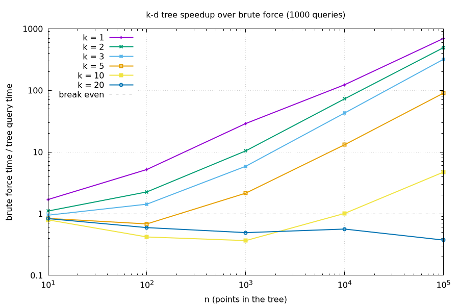

# Assignment 8: K-D Trees vs Brute Force Nearest Neighbor

I built a k-d tree that works for any dimension k, compared its nearest neighbor search to brute force, and checked when the tree is actually worth it.

- `KDTree.hpp`: k-d tree (build + find nearest neighbor), median found with quickselect
- `BruteForce.hpp`: brute force nearest neighbor
- `Tests.cpp`: unit tests
- `Benchmark.cpp`: `runExperiment`, prints the results and draws `speedup.png` with gnuplot

## Benchmark setup

- Points: random, every coordinate in [0, 1).
- k = 1, 2, 3, 5, 10, 20 and n = 10, 100, ..., 100000 points in the tree.
- 1000 random query points for each (k, n). Every time is the average of 5 runs.

## Results

Speedup = brute force time / tree query time (above the dashed line means the tree is faster):

## When does the k-d tree win?

The k-d tree wins when k is low and n is big. For k <= 5 it's faster from n = 1000 on (k = 1-3 even earlier), and the bigger n gets the more it wins by, so at n = 100000 it's way faster than brute force. When n is tiny there's no big difference: at n = 10 the two are about the same, since there's barely anything to skip and the recursion costs about as much as just checking 10 points. When k is high the tree loses. At k = 10 it only catches up around n = 10000 and is just a little faster after that, and at k = 20 it's slower than brute force for every n.
